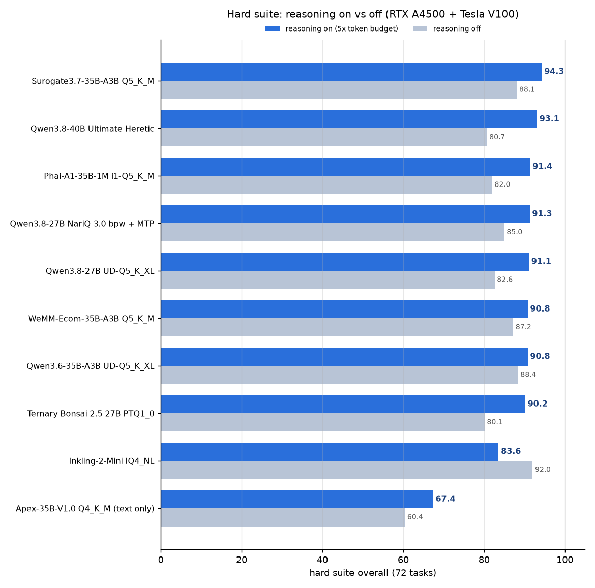

# DualGPU: LLMs on an RTX A4500 + Tesla V100

Run and tune local LLMs with llama.cpp split over two different GPUs, served on `http://127.0.0.1:8899/v1` (OpenAI API).

| | GPU | VRAM | memory BW | arch |
|---|---|---|---|---|
| CUDA0 | RTX A4500 | 20 GB | 640 GB/s | sm_86 |
| CUDA1 | Tesla V100-SXM2 (PCIe adapter) | 16 GB | 900 GB/s | sm_70 |

Rest of the PC: Xeon E5-2660 v4, X99, 64 GB RAM, Windows 11, both cards on PCIe 3.0 x16.
CUDA0/CUDA1 are pinned by GPU UUID in `tools/common.ps1`, so `-ts a,b` always means A4500,V100 whatever slots the cards are in.

## Quick start

**GUI** (same launcher as V100-LLM): `START-GUI.bat` opens http://127.0.0.1:7860. Pick a model and preset, Load, chat with
images, edit any flag, and watch tok/s plus VRAM / load / power for each GPU. The model is served at
`http://127.0.0.1:8899/v1` (OpenAI API) for any other app.

**Command line:**

```bat
start.bat                                 :: list models and presets
start.bat orcacyber-nano-27b              :: a model's default preset
start.bat minicpm-v4.7-35b-a3b fast       :: a named preset
```

## Leaderboard (hard suite, 72 tasks, same tasks and scoring as V100-LLM)

| # | model (quant, size) | preset | ctx | gen tok/s | coding | reasoning | instr | search | agent | vision | longctx | **overall** |
|---|---|---|---|---|---|---|---|---|---|---|---|---|
| 1 | Inkling-2-Mini Uncensored AD-IQ3_S (13.3 GB, AtomicChat, looped MoE, **V100 only**, reasoning effort minimal), vision | `v100` | 32k | 32.2 | 81 | 100 | 100 | 100 | 83 | 100 | 100 | **94.9** |
| 2 | Inkling-2-Mini Uncensored AD-Q4_K (16.5 GB, AtomicChat, looped MoE, A4500 only, reasoning effort minimal), vision | `32k` | 32k | 34.9 | 88 | 100 | 83 | 100 | 83 | 100 | 100 | **93.4** |
| 3 | Qwen3.8-40B Ultimate Heretic (DavidAU) MTP-Q4_K_M (24.2 GB, dense, MTP), vision, **thinking on**† | `64k` | 64k | 37.3 | 81 | 100 | 83 | 100 | 100 | 88 | 100 | **93.1**† |
| 4 | Inkling-2-Mini IQ4_NL (17.6 GB, looped MoE, A4500 only, reasoning effort minimal), vision | `32k` | 32k | 35.1 | 81 | 100 | 92 | 100 | 83 | 88 | 100 | **92.0** |
| 5 | Qwen3.8-27B UD-Q4_K_M (16.6 GB, dense, MTP), vision | `128k` | 128k | 58.8 | 94 | 100 | 42 | 100 | 100 | 100 | 100 | **90.8** |
| 6 | Huihui Gemma-4-26B-A4B-it QAT abliterated Q4_K (16.8 GB, MoE), vision | `262k` | 262k | 86.5 | 88 | 100 | 83 | 88 | 100 | 75 | 100 | **90.5** |
| 7 | OrcaCyber-Nano 1.0 27B Mix-15.7G (MTP), vision | `128k` | 128k | 61.6 | 94 | 100 | 50 | 100 | 100 | 88 | 100 | **90.2** |
| 8 | Inkling-2-Mini UD-Q4_K_XL on the **Maya engine** (17.6 GB, A4500 only, reasoning effort low), vision | `start-maya.bat` | 64k | 90.0 | 81 | 100 | 75 | 100 | 83 | 88 | 100 | **89.6** |
| 9 | Qwen3.6-35B-A3B UD-Q5_K_XL (25.3 GB, MoE, MTP), vision | `128k` | 128k | 99.6 | 94 | 100 | 50 | 88 | 100 | 88 | 100 | **88.4** |
| 10 | Surogate3.7-35B-A3B Q5_K_M (25.3 GB, MoE, MTP, converted here), vision | `128k` | 128k | 105.3 | 100 | 100 | 42 | 88 | 100 | 88 | 100 | **88.1** |
| 11 | MiniCPM-V 4.7 35B-A3B Q6_K (26.6 GB), vision | `128k` | 128k | 83.6 | 94 | 100 | 33 | 88 | 100 | 88 | 100 | **86.0** |
| 12 | Qwen3.8-27B UD-Q5_K_XL (20.9 GB, MTP), vision | `128k` | 128k | 51.3 | 88 | 95 | 58 | 100 | 100 | 88 | 50 | **82.6** |
| 13 | Qwen3.8-27B pi-adapted (harness-hub LoRA on UD-Q5_K_XL 21.0 GB + 0.3 GB, MTP), vision | `128k` | 128k | 43.8 | 81 | 100 | 50 | 100 | 100 | 88 | 50 | **81.2** |
| 14 | Qwen3.8-27B UD-Q5_K_XL (21.0 GB, unsloth update 2026-11-12, MTP), vision | `128k` | 128k | 51.3 | 75 | 100 | 50 | 100 | 100 | 88 | 50 | **80.4** |
| 15 | Ripple-65B Preview AD-IQ3_XXS (28.0 GB, dense), text only | `64k` | 64k | 13.9 | 75 | 100 | 83 | 100 | 100 | - | 100 | **79.8**\* |
| 16 | Kintsugi-27B (Qwen3.8-27B at 2.47 bpw, 10.5 GB, EXL3 trellis, A4500 only, MTP), vision | `128k` | 128k | 89.6 | 88 | 95 | 42 | 88 | 83 | 88 | 50 | **76.1** |
| 17 | Inkling-2-Mini SQ-15 on the **Strata 0.2.19 engine** (14.35 GB, A4500 only, reasoning effort low), text only here | `start-maya.bat strata` | 64k | 74.3 | 81 | 95 | 50 | 100 | 83 | - | 50 | **65.6**\* |
| 18 | Apex-35B-V1.0 Q4_K_M (21.7 GB, MoE, fine-tune of Qwen3.6-35B-A3B), text only | `262k` | 262k | 100.2 | 50 | 85 | 25 | 63 | 100 | - | 100 | **60.4**\* |
| 19 | Kimi-Linear 48B-A3B abliterated i1-Q4_K_M (27.7 GB), text only | `262k` | 262k | 100.9 | 56 | 60 | 50 | 88 | 100 | - | 50 | **57.7**\* |
| 20 | Qwen2.5-Coder-32B PCB GRPO (Simonssb LoRA on Q4_K_M 19.9 GB + 0.5 GB, dense), text only | `32k` | 32k | 20.0 | 63 | 60 | 42 | 75 | 50 | - | 50 | **48.5**\* |

† Run with reasoning on (`eval_thinking`, 5x token budget): with `enable_thinking=false` this model still reasons, into
the answer, without closing `</think>`, which scored 80.7 (instruction following 8.3, coding 68.8). All other rows ran
with reasoning off, so its rank is not a like-for-like comparison: thinking on usually helps instruction following and coding.

\* Text-only models: the suite scores the missing vision category as 0. Over the 6 text categories Ripple averages 93.1, Inkling on Strata 76.6, Apex 70.4
(the best instruction-following score here, 83) and Kimi 67.3. Many reasoning misses are
format (it ends with a LaTeX `\[ ... \]` block, so the graded last line is `\]`), but the coding misses are real bugs.

The V100-only references on the same suite: OrcaCyber Mix-13G 89.8 at 60 tok/s (32k), MiniCPM-V 4.7 Q3 mix 87.5 at
93 tok/s, Qwen3.6-35B-A3B UD-IQ3_XXS 88.4 at 119 tok/s (64k). Two GPUs give the bigger quants and 2-8x the context; for the
small-active MoE models one V100 with a 3-bit quant is faster (the whole model sits on the faster card, no hand-over).

## Leaderboard with reasoning on (hard suite, same 72 tasks)

Same presets as above with reasoning on (`EVAL_THINKING=1`, 5x token budget). Inkling-2-Mini uses reasoning effort high
(`a4500-32k-q8-high`). gen tok/s is the mean over the run. Regenerate the chart and table with `python tools/reasoning_chart.py`.



| # | model | gen tok/s | coding | reasoning | instr | search | agent | vision | longctx | **overall on** | off | change |
|---|---|---|---|---|---|---|---|---|---|---|---|---|
| 1 | Surogate3.7-35B-A3B Q5_K_M | 101.6 | 81 | 100 | 92 | 88 | 100 | 100 | 100 | **94.3** | 88.1 | +6.2 |
| 2 | Qwen3.8-40B Ultimate Heretic | 37.3 | 81 | 100 | 83 | 100 | 100 | 88 | 100 | **93.1** | 80.7 | +12.4 |
| 3 | Qwen3.8-27B UD-Q5_K_XL | 46.1 | 50 | 100 | 100 | 100 | 100 | 88 | 100 | **91.1** | 82.6 | +8.5 |
| 4 | Qwen3.6-35B-A3B UD-Q5_K_XL | 95.3 | 81 | 100 | 92 | 75 | 100 | 88 | 100 | **90.8** | 88.4 | +2.4 |
| 5 | Inkling-2-Mini IQ4_NL | 36.2 | 56 | 100 | 83 | 62 | 83 | 100 | 100 | **83.6** | 92.0 | -8.4 |
| 6 | Apex-35B-V1.0 Q4_K_M (text only) | 101.0 | 31 | 95 | 58 | 88 | 100 | 0 | 100 | **67.4** | 60.4 | +7.0 |

- Reasoning raises instruction following on every Qwen model (Qwen3.8-27B 58 -> 100, Qwen3.6 50 -> 92) and fixes
  Qwen3.8-27B's long-context misses (50 -> 100). It costs coding: Qwen3.8-27B drops 88 -> 50 and Inkling 81 -> 56, mostly
  tasks where the model is still reasoning when the token budget ends and never writes the code.
- Inkling-2-Mini is the only model that loses overall (92.0 -> 83.6; search 100 -> 62 too). Keep it on effort minimal.
  The same run on the unsloth PR build scored 83.0.
- For coding keep reasoning off; for instruction-heavy or long-document work Surogate (94.3, 102 tok/s) or Qwen3.8-27B
  (91.1, 46 tok/s) with reasoning on are the strongest here.

## Presets

| model | preset | config | ctx | KV | tok/s (mean of code + chat) | 7k prompt |
|---|---|---|---|---|---|---|
| orcacyber-nano-27b | **128k** (default) | `auto-mtp3-128k` | 128k | f16 | **58.2** | 974 t/s |
| | code | `auto-dsp15-32k` (DSpine) | 32k | f16 | 52.1 (**78.2** on code) | 793 t/s |
| | 262k | `l55-mtp3-262k-q8` | 262k | q8_0 | 56.5 | 958 t/s |
| qwen3.6-35b-a3b | **128k** (default) | `auto-mtp3-128k` | 128k | f16 | **95.2** (109.7 on code) | 919 t/s |
| | fast | `l60-mtp3-32k` | 32k | f16 | 96.6 (111.0 on code) | 989 t/s |
| | 262k | `auto-mtp3-262k-q8` | 262k | q8_0 | 86.0 | 916 t/s |
| minicpm-v4.7-35b-a3b | **128k** (default) | `auto-nodraft-128k` | 128k | f16 | **87.0** | 1055 t/s |
| | fast | `auto-nodraft-32k` | 32k | f16 | 91.6 | 1055 t/s |
| | 262k | `auto-nodraft-262k-q8` | 262k | q8_0 | 82.3 | 1051 t/s |
| gemma4-31b-ara-heretic | **64k** (default) | `auto-mtp4-64k` | 64k | f16 | **42.7** (48.5 on code) | 784 t/s |
| | fast | `auto-mtp4-32k` | 32k | f16 | 43.8 (50.0 on code) | 831 t/s |
| | 128k | `auto-mtp4-128k-q8` | 128k | q8_0 | 39.3 | 829 t/s |
| qwen3.8-27b-nov12 | **128k** (default) | `l60-mtp3-128k` | 128k | f16 | **47.2** (53.6 on code) | 901 t/s |
| | fast | `l45-mtp4-32k` | 32k | f16 | 48.9 (58.2 on code) | 866 t/s |
| | 262k | `l65-mtp3-262k-q4-ub256` | 262k | q4_0 | 45.3 | 844 t/s |
| inkling-2-mini | **32k** (default) | `a4500-32k-q8-min-s` (A4500 only) | 32k | q8_0 | **58.1** | 853 t/s |
| | think | `a4500-32k-q8-high-s` (reasoning high) | 32k | q8_0 | 57.8 | 809 t/s |
| | 64k | `a4500-64k-q8-ub128-min-s` | 64k | q8_0 | 57.2 | 611 t/s |
| | 128k | `a4500-128k-q4-ub64-min-s` | 128k | q4_0 | 57.7 | 498 t/s |
| inkling-2-mini-uncensored | **32k** (default) | `a4500-32k-min-s` (A4500 only) | 32k | f16 | **54.6** | 887 t/s |
| | think | `a4500-32k-high-s` | 32k | f16 | 53.8 | 816 t/s |
| | 64k | `a4500-64k-q8-ub128-min-s` | 64k | q8_0 | 52.5 | 586 t/s |
| | 128k | `a4500-128k-q4-ub64-min-s` | 128k | q4_0 | 52.8 | 498 t/s |
| | v100 | `v100-32k-q8-ub128-min-s` (**V100 only**, AD-IQ3_S) | 32k | q8_0 | **48.3** | 597 t/s |
| | v100-64k | `v100-64k-q8-ub64-min-s` (V100 only) | 64k | q8_0 | 47.9 | 457 t/s |
| | v100-128k | `v100-128k-q4-ub32-min-s` (V100 only) | 128k | q4_0 | 47.8 | 320 t/s |
| inkling-2-mini (Maya engine) | **64k** (`start-maya.bat`) | `configs/maya/inkling-2-mini-64k.json` (A4500 only, effort low) | 64k | fp8 | **86-92** | - |
| | code | `configs/maya/inkling-2-mini-code.json` (DSpark drafter) | 24k | fp8 | 76 prose, **97-134** code | - |
| | 64k-new | `configs/maya/inkling-2-mini-64k-new.json` (Maya v1.1.73, A4500) | 64k | fp8 | 88 code, 87 prose | - |
| | 128k | `configs/maya/inkling-2-mini-128k.json` (Maya v1.1.73, A4500, experts partly in RAM) | 128k | fp8 | 80 code, 37 prose | - |
| | 262k | `configs/maya/inkling-2-mini-262k.json` (Maya v1.1.73, A4500, experts partly in RAM) | 262k | fp8 | 58 code, 22 prose | - |
| | v100 | `configs/maya/inkling-2-mini-v100.json` (Maya v1.1.73, **V100 alone**) | 32k | fp8 | 52 code, 20-27 prose | - |
| | strata | `configs/maya/inkling-2-mini-strata.json` (Strata 0.2.19 engine, SQ-15 pack, A4500, text only) | 64k | fp8 | 64.4 code, 44.2 prose | ~650 t/s |
| kintsugi-27b | **128k** (default) | `a4500-mtp3-128k-q8` (A4500 only, MTP 3 + lookup) | 128k | q8_0 | **91.8** | 1450 t/s |
| | fast | `a4500-dfl7-32k` (DFlash2 drafter) | 32k | f16 | 92.2 | 1395 t/s |
| | 262k | `a4500-mtp3-262k-q4` | 262k | q4_0 | 91.0 | 1449 t/s |
| surogate-3.7-35b | **128k** (default) | `l60-mtp3-128k` | 128k | f16 | **94.9** (111.0 on code) | 961 t/s |
| | fast | `l60-mtp3-32k` | 32k | f16 | 98.6 (115.8 on code) | 961 t/s |
| | 262k | `auto-mtp3-262k-q8` | 262k | q8_0 | 90.6 | 886 t/s |
| qwen2.5-coder-32b-pcb | **32k** (default) | `auto-nodraft-32k` | 32k | f16 | **20.9** | 684 t/s |
| | code | `auto-draft16-32k` (0.5B draft) | 32k | f16 | 19.6 (**30.6** on code, 8.6 on chat) | 629 t/s |
| | 128k | `l55-nodraft-128k-q4-yarn` | 128k | q4_0 | 20.4 | 549 t/s |
| qwen3.8-27b-pi | **128k** (default) | `l60-mtp3-128k` | 128k | f16 | **40.3** (46.6 on code) | 730 t/s |
| | fast | `l45-mtp4-32k` | 32k | f16 | 43.6 (49.9 on code) | 738 t/s |
| | 262k | `l65-mtp3-262k-q4-ub256` | 262k | q4_0 | 40.4 | 655 t/s |
| qwen3.8-27b-q4km | **128k** (default) | `l60-mtp3-128k` | 128k | f16 | **53.5** (60.2 on code) | 961 t/s |
| | fast | `l50-mtp3-32k` | 32k | f16 | 55.0 (62.0 on code) | 935 t/s |
| | 262k | `l60-mtp3-262k-q8` | 262k | q8_0 | 51.7 | 942 t/s |
| apex-35b-v1 | **262k** (default) | `l60-nodraft-262k` | 262k | f16 | **100.6** | 1133 t/s |
| | 128k | `l60-nodraft-128k` | 128k | f16 | 100.4 | 1127 t/s |
| | code | `auto-mtp3-32k` | 32k | f16 | 92.5 (**110.8** on code) | 923 t/s |
| qwen3.8-40b-heretic | **64k** (default) | `auto-mtp2-64k` | 64k | f16 | **35.7** (37.5 on code) | 580 t/s |
| | code | `auto-mtp4-32k` | 32k | f16 | 34.9 (**38.8** on code) | 586 t/s |
| | 128k | `l55-mtp3-128k-q4` | 128k | q4_0 | 34.5 | 578 t/s |
| muse-glimmer-30b | **128k** (default) | `auto-dfl15-128k` (DFlash) | 128k | f16 | **40.6** (45.5 on code) | 801 t/s |
| | fast | `auto-dfl12-32k` (DFlash) | 32k | f16 | 41.3 (46.8 on code) | 810 t/s |
| | nodraft | `auto-nodraft-128k` | 128k | f16 | 26.6 | 1165 t/s |
| huihui-gemma4-26b-a4b | **262k** (default) | `auto-nodraft-262k` | 262k | f16 | **87.5** | 1808 t/s |
| | fast | `l60-nodraft-32k` | 32k | f16 | 88.9 | 1904 t/s |
| | code | `auto-mtp2-262k` | 262k | f16 | 88.4 (**96.6** on code) | 1699 t/s |
| huihui-qwen3.6-35b-a3b | **128k** (default) | `auto-mtp3-128k` | 128k | f16 | **97.0** (105.4 on code) | 931 t/s |
| | fast | `auto-mtp4-32k` | 32k | f16 | 103.6 (120.9 on code) | 939 t/s |
| | 262k | `auto-mtp3-262k` | 262k | f16 | 93.7 | 927 t/s |
| kimi-linear-48b-a3b | **262k** (default) | `auto-262k` | 262k | f16 | **104.8** | 1299 t/s |
| | fast | `auto-32k` | 32k | f16 | 106.0 | 1276 t/s |
| | 512k | `auto-512k` | 512k | f16 | 102.1 | 1259 t/s |
| nanbeige4.3-33b | **64k** (default) | `auto-64k-q8` | 64k | q8_0 | **23.1** | 1045 t/s |
| | fast | `l50-32k` | 32k | f16 | 23.8 | 1094 t/s |
| | 128k | `auto-128k-q4` | 128k | q4_0 | 22.9 | 1035 t/s |
| ripple-65b | **64k** (default) | `auto-64k` | 64k | f16 | **14.8** | 427 t/s |
| | fast | `l50-32k` | 32k | f16 | 15.2 | 417 t/s |
| | 128k | `auto-128k-q8` | 128k | q8_0 | 14.4 | 404 t/s |
| | 262k | `auto-262k-q4` | 262k | q4_0 | 14.4 | 405 t/s |
| qwen3.8-27b | **128k** (default) | `l60-mtp3-128k` | 128k | f16 | **48.3** | 917 t/s |
| | fast | `layer-auto-mtp3-32k` | 32k | f16 | 50.2 | 952 t/s |
| | code | `auto-dsp15-32k` (DSpine) | 32k | f16 | 49.2 (**71.3** on code) | 759 t/s |
| | 262k | `l65-mtp3-262k-q4-ub256` | 262k | q4_0 | 46.0 | 846 t/s |

All presets pass the image test (vision models) and a ~7k-token prompt. Per-model findings:

- **DSpine** (tencent's 16-token drafter for Qwen3.8-27B, `Qwen3.8-27B-DSpine-b16-Q4_K_M.gguf`, kernel `bin-dspine` =
  the tested source + the DSpine commit of Ajay9o9/llama.cpp `dspine`, `kernel/patches/0003`): best on code, worse on chat.

  | target, 32k f16 | DSpine 15 drafted: code / chat / mean | DSpine 7 | MTP 3 mean |
  |---|---|---|---|
  | Qwen3.8-27B UD-Q5_K_XL | **71.3** / 27.2 / 49.2 (24% accepted) | 58.0 / 28.9 / 43.5 | 50.2 |
  | OrcaCyber Mix-15.7G | **78.2** / 26.1 / 52.1 (23% accepted) | 66.2 / 29.0 / 47.6 | 57.3 |

  It also works on OrcaCyber (a Qwen3.8-27B fine-tune), so both get a `code` preset with it. q8 KV is slower (47.1);
  OrcaCyber runs it at 128k (52.1), Qwen3.8-27B Q5_K_XL does not fit the drafter at 128k.
- **OrcaCyber**: same architecture as Qwen3.8-27B. MTP 3-4 beats its DFlash2 drafter (50.6-51.1). Both GPUs: 57.3 tok/s vs
  47.5 on the A4500 alone. 262k f16 KV does not fit; q8 does, with both cards nearly full.
- **Qwen3.6-35B-A3B**: unsloth's MTP build (MTP head in the file). MTP 3 95 tok/s vs 88 without (MTP 4: 112 on code,
  78 on chat). Splits within 3 tok/s. 262k f16 KV runs text (93.6) but the vision encoder runs out of memory on the
  A4500, so the 262k preset uses q8 KV.
- **Huihui Qwen3.6-35B-A3B abliterated** (Q4_K, 21.7 GB, MTP kept): as fast as the unsloth Q5 (MTP 3 102 tok/s at 32k,
  MTP 4 104, no draft 96) and 3.6 GB smaller, so 262k f16 KV fits with the vision encoder (93.7). Not run on the hard suite.
- **Gemma-4-31B-it ARA heretic** (richardyoung's refusal-removed fine-tune, mradermacher i1-Q5_K_M 21.9 GB, dense,
  vision; main kernel) with Google's MTP drafter for the base model (`gemma-4-31B-it-assistant.Q8_0.gguf` from
  AtomicChat, 0.5 GB): the fine-tune still accepts 61-76% of its drafts, so MTP 4 gives 1.77x (43.8 vs 24.8 tok/s at 32k;
  MTP 2 42.8, 3 42.7, 6 37.7). Splits within 1 tok/s (auto, 50/50, 60/40). Its global layers keep big KV: 64k f16 fits
  (19.6 + 14.2 GB), 128k needs q8 (39.3) or q4 (38.6), 262k does not fit even with q4. GPU log of the whole tune (1 s):
  both cards peak at 100% and average ~50% while busy (layer split = they take turns); V100 power spikes to 271 W over
  its 230 W limit and 84 C, A4500 170 W / 66 C. No crash. Not run on the hard suite.
- **Qwen3.8-27B, unsloth update of 2026-11-12** (`Qwen3.8-27B-UD-Q5_K_XL.gguf` changed in the repo; our old copy is
  kept, so the older results stay valid): MTP built in (72-74% accepted). 45/55 split runs out of V100 memory at 128k and
  262k, so the long-context presets use 60/40 and 65/35. 128k f16 60/40 47.2, 65/35 46.3; 262k q4 with ub 256 45.3; 262k q8
  60/40 does not start. Not run on the hard suite yet.
- **Maya engine for Inkling-2-Mini** (`maya-ik2` from alesha-pro/maya-inkling-mini, built from source with CUDA 13.4 for
  the A4500; not llama.cpp, see `kernel/SOURCE.md`): every one of the 3,072 experts stays in VRAM and a token is one CUDA
  graph (~780 launches against ~7,350 in llama.cpp). On the A4500 with unsloth's `UD-Q4_K_XL`: **86-92 tok/s** at 64k
  (against 58.1 for `bin-inklings`, 36 for upstream llama.cpp). The A4500's 20 GB holds 64k with every expert resident;
  81,920 and up fall back to an expert cache in system RAM (12-17 tok/s). The official DSpark drafter (0.76 GiB) fits
  with 24k context: 134 tok/s on a code answer, 97 on another, prose 76 (drafting does not pay on free text). Hard suite
  **89.6** at 64k with reasoning effort low, images on the CPU encoder (coding 81, instructions 75, vision 88, long context
  100). Effort: Maya's server does not open the reasoning block itself, so at `minimal` the model does not reason at all
  (hard suite 63.6 text only: instructions 42, long context 50); llama.cpp's Inkling parser opens it, which is why its
  `minimal` runs score like Maya's `low`. Start: `start-maya.bat` (64k) or `start-maya.bat code`, port 8899, A4500 only;
  it can run next to `start.bat inkling-2-mini-uncensored v100 8900` on the V100. **In the GUI** (and so in the phone /
  desktop app) it is the model `inkling-2-mini-maya` with presets `64k` and `code` (engine type `maya`: the launcher fills
  in the `configs/maya` template, starts Maya's Python server from venv `D:\venvs\maya` with only the A4500 visible, and
  stops the whole process tree). `64k` takes ~140 s to load (14.7 GiB of experts copied to VRAM), `code` ~40 s. No
  tune.ps1 support.
- **Maya v1.1.73 for Inkling-2-Mini: the V100 and longer context** (mw00/project-maya, built from source with CUDA 12.9
  for sm_70 + sm_86 in `kernel/build-maya2`; CUDA 13 has no sm_70). It keeps the experts that do not fit in pinned RAM,
  the most-picked ones (its profile `data/expert-profile-ik2mini.bin`, `IK2_WARM`) in VRAM, and runs on the V100 with its
  own `mma.m8n8k4` kernels. Presets (`start-maya.bat <preset> [port]` and the GUI), code / prose tok/s:
  `v100` (V100 alone, 32k) **52** / 20-27, the A4500 stays free (coding 87.5, reasoning 90 on a partial hard suite, vision
  passes); `64k-new` (A4500, every expert resident) **88** / 87; `128k` 80 / 37; `262k` 58 / 22. Prose is slower once
  experts come from RAM: the profile favours the experts code uses. unsloth's `UD-Q3_K_XL` does not load (IQ2_XS experts).
  **Two cards are slower than one** (262k, synthetic decode): A4500 alone with RAM offload 39.9 tok/s, layer split 25.8,
  expert parallel (`IK2_EP=1`) 14.5, and an uneven split tried here (layers 0-5 / 6-23: 34.8; 0-17 / 18-23: 19.3); the
  A4500 and V100 have no peer access, so every hop goes through RAM, which costs more than fetching experts. Maya has no
  option to put only the KV cache on the second card.
- **Strata 0.2.19 for Inkling-2-Mini** (Niko1221/Strata, its prebuilt `strata-inkling` 0.1.65 CUDA 12 engine in
  `kernel/strata-inkling`, and the `SQ-15` pack from `strata-engine/Inkling-2-Mini-Strata`, 14.35 GB, checksums verified).
  The engine speaks Maya's line protocol, so Maya's server runs it: preset `strata` (`start-maya.bat strata`, the GUI),
  A4500 alone, 64k, FP8 KV, its built-in DSpark drafter. **64.4 tok/s on code, 44.2 on prose** (its own `--bench`: 77.2
  with DSpark, 43.1 without), 8k prompt ~650 tok/s, load ~2 min. Slower than Maya's `64k-new` (88 / 87) on the same card:
  Strata's fast kernels target RTX 40 / 50 (sm_89 / sm_120). Hard suite **65.6**, text only (Maya's image-encoder command
  is "unknown" to it, and its own vision pack only works inside the Strata app): coding 81, reasoning 95, instructions 50,
  search 100, agent 83, long context 50; 76.6 over the 6 text categories against Maya's 89.6 (with vision). The V100 was
  not tested (it was busy with another server). `--bench` reads only `.strata` packs, not GGUF.
- **Inkling kernel `bin-inklings`** (realugbun's `inkling2-speed` fork of llama.cpp: upstream `e50c254a` + fused CUDA
  kernels for Inkling 2's small op chains): every Inkling preset runs on it. Against `bin-inklingm` with the same files and
  settings: A4500 base 36.3 -> 58.1 tok/s, uncensored 37.5 -> 54.6, V100 IQ3_S 33.0 -> 48.3, 128k 36.9 -> 52.8; 7k prompts
  1.4-1.9x. Q4_K split 4/44 18.3 -> 34.3 (still below one card). Hard suite on the fork: base 90.8 (92.0 upstream),
  uncensored 91.7 (93.4): one or two tasks apart, inside the 89.9-94.9 spread of the Inkling runs.
- **Inkling-2-Mini** (Thinking Machines; new looped architecture: 24 layers of weights, the middle 12 run three times = 48
  layer passes per token, MoE 8 of 128 experts, local + global attention, vision). Kernel `bin-inklingm` = llama.cpp master
  `e50c254a` (2026-11-21, Inkling-2-Mini merged in #32694 + #32704) with ggml-org's `IQ4_NL` (17.6 GB, merged layout): 36-38
  tok/s on **one A4500**. First run (2026-11-21 night): unsloth's `UD-Q4_K_M` on `bin-inkling` (master `91979450` + the then
  unmerged PR #32695, whose GGUF layout master does not load) made 29.7; its results are kept as `*-unsloth-pr32695`.
  Over both cards it stays slow on either kernel (4.7-9.4 tok/s): each looped layer's weights sit on the card of its first
  pass and the later passes hop cards (~400 graph splits per token); `-sm row` / `-sm tensor` are not supported for it. Its
  compute buffer grows with context x ubatch (3.3 GB at 32k x 512), and the IQ4_NL fills the A4500 at 32k f16 / ub 256
  (20.2 GB, 30.7 tok/s), so 32k runs with q8 KV, 64k with ub 128 + q8 KV, 128k with ub 64 + q4 KV (slower prompts, ~295
  t/s). The chat template ignores `enable_thinking` and defaults to reasoning effort 0.9 (high); the `-min` configs set
  `reasoning_effort: minimal` as the server default (`--chat-template-kwargs`; `Start-Srv` now quotes arguments so JSON
  values survive). DSpark (unsloth's drafter) did not load (vocabulary padding; DSpark for Inkling is PR #32218, open).
  unsloth UD-Q4_K_M, first run: hard suite 89.9 (effort minimal) / 83.0 (effort high: coding 56, search 63, a coding task
  took 48 min).
  IQ4_NL on `bin-inklingm`: hard suite **92.0** on `32k` (effort minimal; instructions 92, the best on the board, coding 81).
- **Inkling-2-Mini Uncensored** (AtomicChat: rank-1 LoRA removing each layer's refusal direction, baked into their AD-Q4_K
  16.5 GB; their numbers: 0 refusals on the harmful test sets, XSTest over-refusal 0, MMLU 79.15 vs 80.65). Merged layout,
  kernel `bin-inklingm`, A4500 only: 37.5 tok/s at 32k f16 (fits at 19.8 GB), 128k q4 36.9. Hard suite **93.4** on `32k`
  (effort minimal; coding 88, vision 100), the top of the board without reasoning on; one run each, so the 1.4 points over
  the base model are within run-to-run noise (temperature 0, but a few tasks flip).
  **V100 only**: AtomicChat's AD-IQ3_S (13.3 GB) on the Tesla V100 alone, 33.0 tok/s at 32k (q8 KV, ub 128), 32.8 at 128k
  (q4 KV, ub 32); 32k with f16 KV / ub 256 runs out of memory on the image test. New config field `gpu` ("V100"/"A4500"):
  llama-server sees only that card (`CUDA_VISIBLE_DEVICES`), so the other card stays empty, and `start.bat <model> <preset>
  <port>` leaves servers on other ports running. Both at once, tested: `start.bat inkling-2-mini` (A4500, port 8899) at
  37.4 tok/s and `start.bat inkling-2-mini-uncensored v100 8900` (V100) at 32.6 tok/s, answering at the same time. (The GUI
  runs one server at a time; there the v100 presets use `-sm none -mg 1` with both cards visible.)
  Hard suite on `v100` (IQ3_S, V100 alone): **94.9** (instructions 100, vision 100, coding 81) - above the Q4_K on the A4500
  (93.4), so the difference between these runs is noise, not the quant. Q4_K split with most layers on the V100 (`-ts`
  over the 48 looped slots): 4/44 18.3 tok/s (A4500 4.9 GB, V100 15.7 GB), 5/43 14.9, 6/42 12.7, 8/40 9.8; 2/46 and 3/45
  run the V100 out of memory. Half the speed of one card at best, so the one-card presets stay.
- **Surogate3.7-35B-A3B** (surogate: Qwen3.5-35B-A3B-Base with agentic post-training, MTP head, vision; their numbers
  SWE-bench Verified 78.0, IFEval 94.1, GPQA 91.4). No GGUF was published, so it was converted here from the BF16
  weights (13 shards, sha256-checked; `kernel/src` `convert_hf_to_gguf.py`, MTP kept as `nextn`, the vision projector with
  `--mmproj`) and quantized to **Q5_K_M** (25.3 GB, no imatrix; `llama-quantize` is now built in `kernel/bin`). Same
  architecture and settings as Qwen3.6-35B-A3B: 98.6 tok/s at 32k (60/40, MTP 3), 94.9 at 128k, 90.6 at 262k q8; MTP
  accepts 59-75%. Hard suite **88.1** on `128k` with thinking off (coding 100, agent 100, long context 100, instructions
  42); with reasoning on (`eval_thinking`, 5x tokens) **94.3** (instructions 92, vision 100, coding 81). Both runs in
  `results/hard/`. The GGUF and mmproj are uploaded to
  [abdelhayali91/Surogate3.7-35B-A3B-GGUF](https://huggingface.co/abdelhayali91/Surogate3.7-35B-A3B-GGUF), where the GUI's
  Download fetches them.
- **Kintsugi-27B** (CaryPalmer / professorpalmer: Qwen3.8-27B at 2.47 bits per weight, 10.5 GB, Escha W2 / EXL3 trellis
  weights; only its own engine loads it: kernel `bin-kintsugi`, their llama.cpp fork built from the release source for
  sm_86, see `kernel/SOURCE.md`). RTX A4500 only (no V100 kernels). Engine switches from their `start-server.ps1` as the
  config's `env` (new: per-model environment variables in configs, tools and the GUI), their fixed chat template
  (new config field `chat_template`), and Qwen3.8-27B's own vision projector (the Kintsugi repo has none). On 20 GB the
  whole K/V cache fits in VRAM up to 262k (q4 KV), so their RAM-tiered cache is not needed: 91-92 tok/s at 32k, 128k and
  262k with MTP 3 + lookup or the DFlash2 drafter (the same here), 1,400-1,450 t/s on the 7k prompt. Drafting matters: a
  600-token code answer without it 31 tok/s, with it 91. Hard suite **76.1** on `128k` (coding 88, reasoning 95, vision
  88, search 88, but instructions 42 and long context 50, like the Qwen3.8-27B Q5 runs).
- **Qwen2.5-Coder-32B PCB GRPO** (Simonssb: LoRA r=32, QLoRA SFT + GRPO on 254 KiCad boards; from a netlist/footprint
  summary it writes `groups.json` + `routing_strategy.json` for drandyhaas/KiCadRoutingTools). The HF repo only has the PEFT
  adapter, so it was converted here (llama.cpp `convert_lora_to_gguf.py --outtype f16`, 537 MB, in the repo release
  `lora-qwen2.5-coder-32b-pcb`) and runs with `--lora` on Qwen's official Q4_K_M (it was trained on a 4-bit base). Dense
  32B, no MTP: 20.9 tok/s, all splits within 0.2. Speculative decoding with Qwen2.5-Coder-0.5B as draft (new `spec: draft`)
  helps code (27.9 at 8 tokens, 30.6 at 16) but halves chat (8.6-12.7; only 14-26% accepted with p-min 0, 73-88% with
  p-min 0.6-0.8 but still slower), so the default runs without it; n-gram lookup (new `spec: ngram`) changes nothing.
  Native context 32k; f16 KV does not fit 64k, 64k q8 (20.4) and 128k q4 (20.4) run with YaRN.
  Hard suite 48.5 on `32k` (text 6 average 56.5): the PCB training shows - it answers reasoning questions with a bare
  number at once, no working (60), and does not finish the agent tasks with tool calls (50). Not a general model; use it
  for its KiCad planning prompts.
- **Qwen3.8-27B pi-adapted** (harness-hub: a LoRA adapter, RL-trained with GRPO, that tunes Qwen3.8-27B for the pi
  coding agent; their numbers on BF16, thinking off: Terminal-Bench 2.1 39.5 -> 55.8, SWE-bench Pro hard-51 29.4 -> 62.7).
  Their 319 MB `Qwen3.8-27B-pi-lora-F16.gguf` is loaded with `--lora` (new `"lora"` field in the model config) on the
  2026-11-12 UD-Q5_K_XL base (hardlinked, no second copy; the authors suggest a Q8_0 base). The LoRA costs ~15% speed
  against the plain Q5 (128k 40.3 vs 47.2, MTP 4 32k 43.6 vs 48.9); MTP still 1.9x (23.0 without), 67-77% accepted, so
  the untouched MTP head still matches. All 7 configs pass, including 262k with q4 KV (40.4).
  Hard suite 81.2 on `128k` (coding 81, instructions 50, long context 50), the same as its base (80.4): their gains are
  for agent work inside the pi harness (100-step tasks), which this suite does not test.
- **Qwen3.8-27B UD-Q4_K_M** (same repo, 16.6 GB; hard suite 90.8 on `128k`, the top of the leaderboard, with instruction following at 42, the lowest of the top models): about 13% faster than Q5 (53.5 vs 47.2 at 128k). 262k q8 fits at 60/40
  (51.7). Its 128k run with the 45/55 split crashed the CUDA process (the V100 was full); the 60/40 split works.
  GPU log (1 s) for the Q5 tune: V100 peaks 265 W over its 230 W limit at 84 C; A4500 167 W / 66 C. No crash.
- **Apex-35B-V1.0** (Apex Intelligence fine-tune of Qwen3.6-35B-A3B for coding, tools and agent work; their GGUF Q4_K_M
  21.7 GB, MoE, text only - the GGUF repo has no vision projector; main kernel): no draft is fastest, ~100 tok/s on the
  60/40 split at every context (32k 99.3, 128k 100.4, 262k f16 100.6; auto split 93-96, 50/50 95.5). The GGUF keeps the MTP
  head: MTP 3 gives 110.8 on code but 74.3 on chat (60% accepted), MTP 2 85.8 mean, so MTP is only the `code` preset.
  Hard suite 60.4 on `262k` (70.4 over the 6 text categories), far below its base Qwen3.6-35B-A3B (88.4): real misses
  (code missing `import re` / `import heapq`, wrong arithmetic, wrong word counts, failed search lookups). With reasoning on
  (`eval_thinking`, 5x tokens) 67.4: reasoning 95, instructions 58, search 88, but coding 31 (it reasons until the token
  budget runs out and never writes the function). Both runs in `results/hard/`.
- **Qwen3.8-40B Ultimate Heretic Turbo-Brilliance** (DavidAU: Qwen3.8-27B heretic fine-tune expanded to 40B and trained
  again; `MTP-Q4_K_M` 24.2 GB, dense, MTP built in, vision; main kernel): MTP gives 1.65x (MTP 2 35.6, 3 35.3, 4 34.9 tok/s
  vs 21.5 without, 58-74% accepted). Splits within 0.3 tok/s (auto, 50/50, 55/45, 60/40). Its KV is large (128k f16 needs
  ~14 GB), so 64k f16 is the default; 128k runs with q4 KV (34.5) or q8 KV at 60/40 (32.3, A4500 full at 20.2 GB);
  128k q8 at 55/45 crashed on the image test; 262k does not fit even with q4. Hard suite 93.1 on `64k` with reasoning
  on (see the leaderboard note); misses: 3 coding (2 type bugs, roman numerals), 2 instruction tasks, 1 chart value. No crash.
- **Muse Glimmer 30B** (Meta, unsloth UD-Q5_K_XL 21.8 GB, dense, vision; runs on the main kernel): 52 layers, 39 of them
  sliding (2048) and only 2 KV heads, so 128k f16 KV is cheap. Meta's DFlash drafter (`dflash-kquant.gguf`, 1.63 GB, block
  16) gives 1.5x: no draft 26.6, DFlash 7 31.0, 10 40.1, 12 41.3, 15 40.9 at 32k (15-23% accepted), 128k 40.6; q8 KV is
  slower (35.2); auto split beats 50/50 (36.5) and 60/40 (36.8). DFlash costs prompt speed (7k prompt 800 vs 1165 t/s).
  It always reasons first (`reasoning_strength` low..xhigh, default high; `enable_thinking=false` has no effect), so the
  tune image test now allows 1500 tokens (200 was used up by its reasoning; vision itself works).
  Hard suite: the PC went down twice at the same point (the `search` category, ~5 min in, `128k` preset): first a
  bugcheck 0x133 (DPC watchdog, corrected PCIe errors on the A4500's root port), then a freeze. Before that it had coding
  87.5, reasoning 100, instruction following 91.7. Not rerun; every other model passes the suite.
- **Huihui Gemma-4-26B-A4B-it QAT abliterated** (Q4_K, 16.8 GB, separate MTP drafter `mtp-ggml-model-bf16.gguf`,
  arch `gemma4-assistant`; runs on the main kernel): ~4B active, fastest prompt processing here (1700-1900 t/s). The MTP
  drafter barely pays off (no draft 86-89, MTP 1 84.2, MTP 2 86.8, MTP 4 82.6, MTP 6 74.4 at 32k): MTP 2 helps code
  (95-97) but costs chat (76-82 vs 86-89), so the default is no draft and `code` uses MTP 2. Most layers use sliding
  windows, so 262k f16 KV with vision costs nothing (87.5 vs 86.1 at 32k, 14.4 + 12.2 GB); q8 KV is slower (69.9).
  Hard suite on `262k`: **90.5**, the top score here (instruction following 83, tied best; vision 75).
- **MiniCPM-V 4.7**: MoE with ~3B active, so the DSpark draft is a loss here (n8 66.0, n15 54.2 vs 91.6 without, 18-32%
  accepted). 40/60 split and 262k f16 KV do not fit.
- **Kimi-Linear**: 20 linear-attention (KDA) + 7 MLA layers, so 512k context costs little. 1M does not fit (needs a 4.6 GB
  more buffer on the A4500); q8_0 KV is impossible (V head dim 72), and mixed K/V types are not supported for this model.
- **Nanbeige4.3-33B**: dense Llama (runs on the main kernel). ~23 tok/s whatever the split (50/50 23.8, auto 23.5,
  60/40 23.0). Every one of its 52 layers keeps a full KV cache (~210 KB/token f16), so context is the limit: 64k needs q8
  KV, 128k q4, 262k does not fit; with a 50/50 split the 64k/128k configs crash on the 7k prompt (V100 full).
  Hard suite: only the coding category was run (stopped on request): **81.2** on `64k` (Ripple 75, the top models 94).
- **Ripple-65B Preview**: 65B dense, so every token reads all 28 GB: ~15 tok/s whatever the split (auto 15.0, 50/50 15.2,
  60/40 14.5). Only 16 of 80 layers keep a full KV cache (the rest slide over 1024 tokens), so 262k fits with q4 KV at the
  same speed. New `ricursive` architecture: it runs on `kernel\bin-ripple`, the tested source plus AtomicChat's port
  (`kernel/patches/0002-ricursive-port-applied.patch`), built with `tools\build-kernel.bat <cuda> ripple`.

### Qwen3.8-27B presets in detail

| preset | config | ctx | KV | split A4500/V100 | tok/s (code / chat) | 7k prompt |
|---|---|---|---|---|---|---|
| **128k** (default) | `l60-mtp3-128k` | 128k | f16 | 60/40 | **48.3** (54.2 / 42.3) | 917 t/s |
| fast | `layer-auto-mtp3-32k` | 32k | f16 | auto | **50.2** (55.9 / 44.4) | 952 t/s |
| 262k | `l65-mtp3-262k-q4-ub256` | 262k | q4_0 | 65/35 | **46.0** (51.8 / 40.2) | 846 t/s |

All three use `-sm layer`, MTP 3 (built-in draft head), `-b 2048 -ub 512` (262k: ub 256), flash attention, vision on.

## Qwen3.8-27B results

Model: `unsloth/Qwen3.8-27B-GGUF` UD-Q5_K_XL (20.9 GB) + mmproj-F16. Speed = mean of a code and a chat reply
(300 tokens, temperature 0, thinking off). Every config must also read the test image and answer a ~7k-token prompt.
Power limits during these runs: V100 300 W, A4500 170-200 W.

### Hard suite (same tasks and scoring as the V100-only setup)

| setup | overall | coding | reasoning | ifeval | search | agent | vision | longctx | gen tok/s | prompt tok/s |
|---|---|---|---|---|---|---|---|---|---|---|
| **this: Q5_K_XL, A4500 + V100, 128k** | **82.6** | 87.5 | 95.0 | 58.3 | 100 | 100 | 87.5 | 50 | 51.3 | 884 |
| ref: unsloth UD-IQ3_S, V100 only, 32k | 88.4 | 93.8 | 100 | 50.0 | 100 | 100 | 75.0 | 100 | 52.1 | 460 |
| ref: ByteShape IQ4_XS, V100 only, 32k | 84.2 | 93.8 | 100 | 58.3 | 100 | 100 | 87.5 | 50 | 53.7 | 531 |

The suite is small: longctx is 2 questions (one miss = -7 overall), coding 16 tasks. The gap to IQ3_S is one long-context
question (Teo's daughter's birth year) plus two coding tasks, so quality is about the same; the bigger quant did not buy points
here. What two GPUs do buy: the same generation speed with a 5-6 GB larger quant, 4-8x the context (128k-262k vs 32k),
and ~1.9x faster prompt processing.

### Launch-config tuning (`results/tune-qwen3.8-27b.jsonl`, `python tools/report.py`)

| what | result |
|---|---|
| split ratio (32k, MTP 3) | auto 50.2, 45/55 49.7, 60/40 49.2, 50/50 49.1, 40/60 47.0 tok/s: flat within ~1 tok/s |
| speculative decoding | none 26.7, MTP 2 45.9, **MTP 3 49.7**, MTP 4 49.1 (code 59.6, chat 38.6), DFlash2 n4 46.7, n6 47.9 |
| DFlash draft on the A4500 | does not start (draft shares `output.weight`, which lives on the V100) |
| KV cache (32k) | f16 49.7, q8_0 47.5 |
| ubatch (b 2048) | ub 256 49.2 / 800 t/s prefill, **ub 512** 49.7 / 896, ub 1024 48.9 / 904 |
| b = ub = 256 (no pipelined prefill) | 34.7 tok/s, 405 t/s prefill (measured with both cards capped at 100 W) |
| 128k | 45/55: V100 out of memory; **60/40 f16 48.3**, 60/40 q8 47.3 |
| 262k | q8 does not fit (or crashes on the image); **q4 60/40 47.0** (V100 at 16.1 GB, too tight), **q4 65/35 ub 256 46.0** |
| `-sm row` | does not start in this build ("CUDA0 does not support split buffers") |
| `-sm tensor` | ~55 tok/s on code, then **cut the power** of the PC (both GPUs at full load together). Do not use. |

## Power notes (read this before you try heavy configs)

- With the original **500 W PSU** the PC shut off hard (Kernel-Power 41, no BSOD) four times: three times in pipelined prefill
  (`-b 2048 -ub 512`, both GPUs computing at once) and once even with b = ub. Cause: the PSU, not PCIe bandwidth
  (layer split moves ~40 MB per ubatch).
- After the PSU was replaced, all layer-split configs pass at full power limits. `-sm tensor` still cut the power, because
  it runs both cards at full load for every token.
- On a weak PSU: set `"b"` equal to `"ub"` in a config (the cards take turns), lower the power limits, and avoid tensor split.

## Layout

```
START-GUI.bat           the GUI (gui/launcher.py + ui.html, from V100-LLM, adapted to two GPUs) on :7860
catalog.json            what the GUI shows: generated by tools\make-catalog.ps1 (do not edit by hand)
start.bat               start a preset:  start.bat <model> [preset]
presets.json            tested presets per model
configs/<model>.json    model files, sampling, every launch config and named sets
tools/tune.ps1          run configs: tools\tune.ps1 <model> [names] | -Set <set>   -> results/tune-<model>.jsonl/.log
tools/eval.ps1          hard suite:  tools\eval.ps1 <model> <config>               -> results/hard/
tools/report.py         markdown tables from the results
tools/fill-hashes.py    sizes + sha256 of model files from Hugging Face -> configs/files.json (GUI downloads)
tools/make-catalog.ps1  configs + presets + results -> catalog.json (same launch args as start.bat)
tools/build-kernel.bat  build llama.cpp (CUDA 12.9, sm_70 + sm_86) into kernel/bin; [cuda] <x>: kernel/src-x -> bin-x
kernel/                 SOURCE.md + patches (source and binaries are not in git); bin-ripple = + Ripple port
models/<model>/         GGUF files (not in git)
```

Kernel: llama.cpp `f336359` + V100 MMVQ tuning (`kernel/patches/0001-*.patch`), built with CUDA 12.9 (CUDA 13 dropped Volta).
Prebuilt Windows binaries: GitHub release `kernel-da8fd08` (unzip into `kernel\bin`). See `kernel/SOURCE.md`.

## Add a model

1. Put the GGUF (+ mmproj / draft) in `models/<id>/`.
2. Write `configs/<id>.json` (copy `qwen3.8-27b.json`: `gguf`, `mmproj`, `sampling`, `configs`, `sets`).
3. `tools\tune.ps1 <id> -Set <set>`, then `tools\eval.ps1 <id> <best config>`.
4. Add presets to `presets.json` and a section here.
5. `python tools\fill-hashes.py <id>` and `tools\make-catalog.ps1`: the model shows up in the GUI.

The GUI runs one model at a time and kills any other `llama-server` when it loads one, so don't use it while `tune.ps1` or
`eval.ps1` is running.
